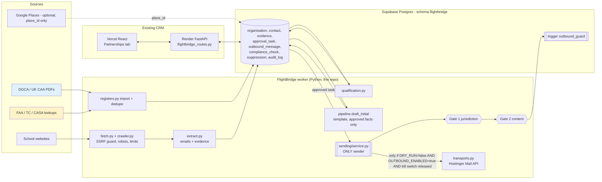

# FlightBridge AI — Phase 2 Architecture and Database Design

Date: **2026-10-31**. Status: corrections applied; schema, CRM approval module, research pipeline and dry-run path implemented and tested.
Safety state: `DRY_RUN=true`, `OUTBOUND_ENABLED=false`, and the DB kill switch is **engaged** by default. No email was sent, no DNS was changed, and no paid service was activated.

## 1. Corrections to Phase 1b (your items 1–10)

| # | Correction | Implementation | Evidence (tests run against Postgres 16) |
|---|---|---|---|
| 1 | Legal conditions verified, not metadata. Separate gates | Gate 1 `compliance/jurisdiction.py`: a condition counts only with unexpired `Evidence` whose method is allowed for that fact (e.g. "relevant to business role" = human-verified only). Gate 2 `compliance/content.py`: each requirement (postal address, opt-out, ad disclosure, privacy notice, contact details, claims, placeholders, subject, ref token) is checked against the **exact body** that will be sent. Gate 2 fails if given no requirements, so it cannot run without gate 1 | `test_jurisdiction.py` (28), `test_content.py` (118) |
| 2 | Official DPDP sources | G.S.R. 843(E) and G.S.R. 846(E) of 13 Nov 2025, read from MeitY's copies; phases 13 Nov 2025 / 13 Nov 2026 / 13 May 2027; S.O. 5458(E) changes no dates | Report F5a; register S32–S32b |
| 3 | RFC 9989 | Replaced RFC 7489. Duplicate records are "all discarded" | Report F1; register S33 |
| 4 | Hostinger threading (investigated, not assumed) | The SDK v1.18.2 generated models expose **no thread id** (message: `messageId`, `inReplyTo`; no `references`). Search has no thread filter. Webhook auth is `Authorization: Bearer <secret>`. The only event is `message.received`. Send returns 204 with no Message-ID. The `thread_id` in Hostinger's marketing example is unverified. Design: local threading, plus a reserved `email_thread.provider_thread_id` column. **Live read-only probe 2026-10-31** (mailbox info@weoneaviation.com): `/me`, `/folders`, `/messages` → 200. Observed message fields: attachments, bcc, cc, date, flags, from, inReplyTo, messageId, path, plainTextSizeEstimate, replyTo, size, subject, to, uid, unseen. **No thread or references field.** The Sent folder path is `INBOX.Sent` (specialUse `\Sent`), so the code now resolves folders by specialUse instead of a hard-coded name. The default python-requests User-Agent got a Cloudflare 403; the official SDK's UA (`hostinger_mail_api-python/1.18.2`) returned 200 | SDK inspection + live probe. **Webhook payload `thread_id` still untested** (needs one webhook capture) |
| 5 | 3-scope suppression | `suppression.scope ∈ {contact, organisation, domain}`, with a CHECK forcing the right column per scope. A DB trigger and the Python index both refuse domain-scope entries for 22 shared providers (gmail.com, outlook.com…). Suppression rows are append-only | `test_org_suppression_does_not_affect_other_org_on_shared_provider`, `test_db_rejects_domain_suppression_of_shared_provider`, `test_shared_provider_domain_cannot_be_domain_suppressed` |
| 6 | Subdomain support confirmed first | Hostinger's domain-setup article (modified 2026-10-29) does not mention subdomains, so it is marked **UNCONFIRMED**. No DNS recommendation stands until Hostinger support or hPanel confirms | Report F1; register S37 |
| 7 | Isolation is risk reduction | Reworded in F1. The RFC 9989 tree walk and provider reputation models can still link a subdomain to its organisational domain | Report F1 |
| 8 | Every missing mandatory requirement blocks | Parametrized over **every** country × address type × requirement: 103 content cases and 9 legal-condition cases, plus invalid-evidence cases (expired, empty, non-http, no verifier, future-dated) | `test_every_missing_mandatory_requirement_blocks[*]`, `test_every_missing_legal_condition_prevents_allow[*]` |
| 9 | Transactional, idempotent, one central sender | `sending/service.py` is the only module allowed to import transports (AST test). Transports refuse construction without the service's private capability token. `outbound_message.idempotency_key` is UNIQUE, and enqueue is `ON CONFLICT DO NOTHING`. The claim `authorized→sending` is a conditional UPDATE. A DB trigger refuses `authorized` unless both checks belong to this row, passed, match its content hash and are under 15 min old. Content is immutable after enqueue. A timeout becomes `send_unknown` and is never auto-retried | `test_fully_enabled_sends_exactly_once`, `test_timeout_becomes_send_unknown_and_is_not_retried`, `test_enqueue_is_idempotent`, `test_db_trigger_refuses_*` (3), `test_content_is_immutable_after_enqueue`, `test_only_sending_service_imports_transports` |
| 10 | Safe defaults preserved | Only the exact string `false` disables DRY_RUN and only the exact `true` enables OUTBOUND_ENABLED. The DB kill switch defaults to engaged, and a missing row also counts as engaged | `test_flag_parsing_is_fail_safe` (6), `test_dry_run_default_renders_and_never_builds_transport`, `test_missing_kill_switch_row_counts_as_engaged` |

## 2. System architecture (existing stack only; no n8n)



**Source of truth**

| Data | Owner | Why |
|---|---|---|
| Regulatory status | `regulatory_approval` (regulator URL + version + check date) | Never from school websites or Google |
| School facts and contacts | `research_fact`, `contact` (school's own page URL) | Places data is not persisted (Maps ToS 3.2.3) |
| Legal-condition facts | `contact_fact_evidence` (excerpt, method, verifier, expiry) | Gate 1 reads only this |
| Human decisions | `approval_task` (CRM writes) | The CRM never writes `outbound_message` |
| What was sent | `outbound_message` + `compliance_check` | Immutable content plus append-only checks |
| Company claims | `config/sender_profile.json` + `docs/COMPANY_FACTS_RECONCILIATION.md` | Null values block the jurisdictions that need them |

There is no sync loop: the CRM and the worker share one database and one schema, each table has one writer role, and nothing is copied between systems.

## 3. Outbound state machine

```
pending_checks ──gates──► authorized ──(DRY_RUN | !OUTBOUND_ENABLED | kill switch)──► dry_run_rendered (terminal)
      │                       └──conditional claim──► sending ──► sent (terminal)
      │                                                     ├──► failed (definite 4xx; terminal)
      │                                                     └──► send_unknown (no auto-retry; reconcile by Ref token)
      ├──► blocked (terminal: gate BLOCK, content FAIL, suppression, missing/mismatched approval)
      └──► needs_review ──human adds evidence, CRM "Re-run checks"──► pending_checks
```

The DB trigger enforces: terminal states cannot reopen; subject, body and recipient are immutable; `authorized` requires fresh passing checks for this row and content hash; a reply without an approval task cannot progress (auto-reply disabled in this release).

## 4. Database (migration `db/migrations/001_flightbridge_schema.sql` = CRM `036_flightbridge_schema.sql`)

The schema is `flightbridge`, so it cannot collide with CRM tables. It is additive and idempotent (applied twice in tests). The only references into `public` are FKs to `public.employee(id)`. A test confirmed the public schema is byte-for-byte unchanged after applying it on top of CRM migrations 001–035.

| Group | Tables | Key constraints |
|---|---|---|
| Control | `system_setting` (kill switches), `audit_log`, `job` | audit append-only; job `idempotency_key` UNIQUE + lease columns for `FOR UPDATE SKIP LOCKED` |
| Regulators | `aviation_authority` (seeded: DGCA, UK_CAA, FAA, TC, CASA, EU_NCA), `regulatory_approval` | classification enum incl. ATO_UK vs DTO_UK, PART141 vs PART61_UNVERIFIED; `next_check_due` |
| Entities | `organisation`, `organisation_identifier` | dedupe on (scheme, value) — DGCA/CAA/FAA/TC/CASA refs, domain, place_id; never on name; `rejected` requires reason |
| Research | `website_page`, `research_fact` | source URL + timestamp per fact |
| Contacts | `contact`, `contact_fact_evidence` | email lower-cased; human evidence requires verifier; expiry |
| Scoring | `qualification_result` | versioned weights, breakdown, missing, risks, confidence |
| Suppression | `suppression`, `public_mail_domain` | per-scope CHECK + partial unique indexes; shared-provider guard; append-only |
| Knowledge | `knowledge_document`, `document_version` | approved facts only, versioned with evidence |
| Mail | `email_thread`, `email_message` | `rfc_message_id` UNIQUE, `(provider_folder, provider_uid)` UNIQUE, `fb_ref_token` UNIQUE |
| Approval | `ai_draft`, `approval_task` | one task per draft; decided ⇒ decided_by/at; approved ⇒ final subject/body |
| Sending | `compliance_check`, `outbound_message`, `follow_up_task` | checks append-only; one live initial email per contact (partial unique index) |

## 5. CRM approval module (repo `nikkk07/CRM`)

- **Backend:** `CRM/backend/flightbridge_routes.py`, mounted with 2 lines in `main.py`. Admin department only. Endpoints:
  - summary
  - approval queue and detail (organisation, regulator records, qualification, contact evidence, thread, draft)
  - decision (approve, edit-and-approve, reject, request more research, resolve, reassign); the edit records the original text in the audit log
  - outbound list with check reasons
  - re-check
  - add human-verified evidence
  - suppression (3 scopes)
  - kill switch

  It never writes `outbound_message` and never sends. If migration 036 is missing, every endpoint returns 503 and the rest of the CRM is unaffected (tested).
- **Frontend:** `components/FlightBridge.jsx`, a lazy-loaded "Partnerships" tab visible to Admin only. Production build passes.
- **Tests:** `CRM/backend/tests/test_flightbridge_routes.py`, 9 passing (existing routes still registered, 403 for non-Admin, 409 on double decision, shared-provider suppression refused, 503 without schema).

## 6. Research pipeline and dry run

```
python -m flightbridge.cli migrate                      # same SQL as CRM 036
python -m flightbridge.cli import-register rows.csv     # validated rows; FAA/TC/CASA need checked_by
python -m flightbridge.cli research <org_id>            # robots-aware crawl, emails + evidence
python -m flightbridge.cli qualify <org_id> --cpl --intl
python -m flightbridge.cli draft <org_id>               # AMBER approval task in the CRM
python -m flightbridge.cli process                      # gates; DRY_RUN => dry_run_rendered
```

The end-to-end test runs register import → dedupe → crawl of a local test site (robots `Disallow` honoured, off-site and asset addresses rejected, Cloudflare-obfuscated and "[at]/[dot]" addresses decoded) → qualification → draft → no output before approval → approval → `dry_run_rendered`.

With the real `config/sender_profile.json`, US/CA outreach is **blocked** until the postal address is signed off (tested), and EU/UK named-person outreach is blocked until a privacy notice exists.

## 7. Open items

| Item | Blocks | Needed from you |
|---|---|---|
| One webhook capture (does the payload carry `thread_id`?) | Final threading decision | Read-only probe done 2026-10-31; still needed: a webhook pointed at an endpoint you control plus one test email |
| Token scope / domain | Least privilege | The token covers "All mailboxes" on weoneaviation.com; narrow it to the single outreach mailbox once chosen |
| Hostinger subdomain support | Any DNS plan | Ask Hostinger support, or check hPanel → Emails → Add domain |
| Postal address, contact mailbox, privacy notice (`sender_profile.json`) | All live sends | Sign off `COMPANY_FACTS_RECONCILIATION.md` |
| Hosting for the worker | Scheduled processing | Decide: run it on demand (Mac Mini / CLI) or approve a paid always-on instance |
| Apply migration 036 in Supabase | CRM Partnerships tab | Paste the file into the Supabase SQL editor (additive; creates schema `flightbridge` only) |
| Inbound mail ingestion, AI classification, follow-ups | Phases 5–7 | Comes after the probe |
